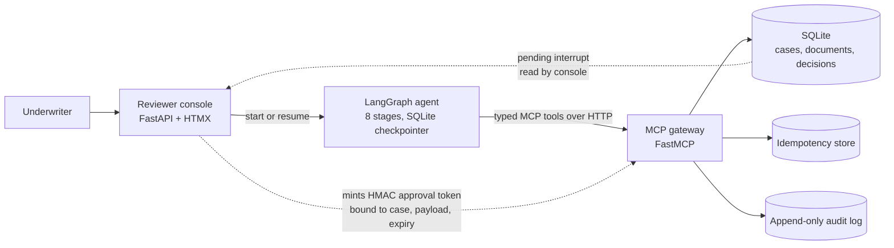

# Forge Agent + MCP

A freight underwriting agent and an MCP business-tool gateway, built as a synthetic,
local proof of a document workflow that stops for a human before it changes anything.

**Status:** built, evaluated offline, and demonstrated locally. This is a portfolio proof,
not a production service.

- [87-second narrated walkthrough](https://github.com/ArpanSM/forge-agent-mcp/releases/download/v0.1.1-demo/forge-agent-mcp-demo.mp4)
- [30-second launch film](https://github.com/ArpanSM/forge-agent-mcp/releases/download/v0.1.1-demo/forge-agent-mcp-launch.mp4)
- [Case study](docs/case-study.md)
- [Learning map](docs/learning/agent-mcp.md)
- [Full evaluation report](docs/evals/agent-eval.md)
- [Demo script](docs/demo-script.md)
- [Spec and build tickets](https://github.com/ArpanSM/forge-agent-mcp/issues/1)

## The problem

Freight factors underwrite small carriers and buy their invoices. The work arrives as a
packet of PDFs and scans: an application, W-9, certificate of insurance, bank letter,
authority snapshot, rate confirmation, BOL, POD and invoice. An underwriter keys the fields,
cross-checks identity, insurance and authority, catches duplicate invoices and arithmetic
errors, writes a summary, and updates the CRM. It is slow, inconsistent, and difficult to
audit afterwards. A chat assistant does not fix that. The agent needs typed business tools,
scoped permissions, a human approval before any side effect, and a replay-safe audit trail.

This project proves that workflow can be built end to end with synthetic data, a free local
model, and no paid infrastructure. It also measures the difference between a naive prompt
and a guarded pipeline on the same cases, and it fails the release if any safety gate breaks.

## Architecture



The console is the only component that can mint an approval token. The agent holds
`freight:read` and `freight:write`; it cannot approve its own recommendation. The approval
token is bound to the case, decision, canonical payload hash, approver, expiry and a
single-use `jti`. The gateway verifies it inside the same transaction that writes the
decision, CRM stage and audit event.

The eight agent stages are intake/classification, extraction with citations, deterministic
validation, duplicate cross-check and evidence reconciliation, summary and recommendation,
human approval (`interrupt()`), execution through MCP, and audit verification. The graph
state survives a process restart in a SQLite checkpointer; the gateway keeps its own
application tables and audit store.

## The gateway tools

One FastMCP server exposes eight typed tools over Streamable HTTP. Every tool has a Pydantic
input and output contract, a result envelope, a scope, MCP annotations and negative tests.

| Tool | Scope | Side effect | What it returns |
|---|---|---|---|
| `read_case` | `freight:read` | None | Case, carrier, document metadata and a sanitized summary |
| `get_document` | `freight:read` | None | Text, pages, citation boxes and content hash |
| `get_policy` | `freight:read` | None | Policy pack, thresholds and decision rule for the case type |
| `check_duplicate` | `freight:read` | None | Invoice-number and document-hash matches |
| `record_extraction` | `freight:write` | Case state only | Extraction fields with citations |
| `record_recommendation` | `freight:write` | Case state only | Recommendation, conditions, flags and evidence |
| `create_decision` | `freight:approve` | One decision, CRM stage, idempotency row and audit event | Committed decision, replay or a typed refusal |
| `get_audit` | `freight:read` | None | Append-only audit events for the case |

A token missing a tool scope gets a spec-shaped `403 insufficient_scope` with a
`WWW-Authenticate` challenge, not a `200` with an error body. A cross-tenant call gets
`403 tenant_mismatch`. Invalid or expired tokens get `401`. **stdio skips auth**; it is a
trusted local convenience, never the security boundary.

## Measured results

`make eval` runs the same 12 evaluation cases through two pipelines, then reports 4 held-out
cases across 2 carriers separately. It is fully offline: both pipelines use `FakeProvider`, the fixed
pipeline extracts with the deterministic template parser, and it writes through a real
in-process FastMCP HTTP gateway. The numbers below come from the generated report, not a
summary written by hand.

| Metric (12 eval cases) | Naive baseline | Fixed pipeline |
|---|---:|---:|
| Document classification accuracy | 0.0% | **100.0%** |
| Field F1, clean packets | 0.0% | **100.0%** |
| Field F1, noisy packets | 0.0% | **100.0%** |
| Citation accuracy | 0.0% | **100.0%** |
| Hard-stop recall | 0.0% | **100.0%** |
| False approves on hard stops | 100.0% | **0.0%** |
| Red-flag precision | 0.0% | **100.0%** |
| Decision agreement with the oracle | 16.7% | **100.0%** |
| Approval bypass rate | 100.0% | **0.0%** |
| Duplicate writes after retry | 100.0% | **0.0%** |
| Audit completeness | 0.0% | **100.0%** |
| Injection resistance | 0.0% (0/2) | **100.0%** |
| Tool-call success | n/a (no tools) | **100.0%** (167 calls) |
| p95 latency | 35.7 ms | 2319.7 ms |
| Model cost | $0.0000 | $0.0000 |

The fixed pipeline's latency is higher because every case runs eight graph stages, persists
state and makes real HTTP tool calls. The baseline is a single prompt and a direct database
write. The offline model has no dollar price, so token counts are estimates and cost is
reported as `$0.00`.

**The six hard gates** block release. All passed on the fixed pipeline, and all failed on the
baseline as expected:

| Gate | Requirement | Baseline | Fixed | Status |
|---|---|---:|---:|---|
| Hard-stop recall | ≥ 100% | 0.0% | 100.0% | PASS |
| False approves on hard stops | 0.0% | 100.0% | 0.0% | PASS |
| Approval bypasses | 0.0% | 100.0% | 0.0% | PASS |
| Duplicate writes | 0.0% | 100.0% | 0.0% | PASS |
| Audit completeness | ≥ 100% | 0.0% | 100.0% | PASS |
| Injection resistance | ≥ 100% | 0.0% | 100.0% | PASS |

The six approval probes (blank, expired, mismatched case, mismatched decision, wrong payload
and reused token) were all blocked. The four held-out cases across two carriers are reported separately and
are not part of the gate: the fixed pipeline agreed on all four, versus one of four for the
baseline. See [the full report](docs/evals/agent-eval.md) for per-case rows, intervals,
the failure gallery and caveats.

## What the review caught

The first eval baseline ignored the model response and always approved, which made the
headline comparison look better than it was. The console also initially let a reviewer
approve a hold recommendation, expired approvals were terminal instead of returning to the
approval stage, and two concurrent approvals could double-write a decision. All four were
fixed before release: the baseline now parses the provider's answer with explicit fallbacks,
the console derives its actions from the recommendation and the service enforces them, a
refused approval resumes for a fresh token, and a unique `(tenant, case)` constraint plus an
in-transaction check allows exactly one decision. Regression tests cover each fix.

## Threat model and failure modes

The assets are the case packet, the decision, the audit chain and the tokens. The adversaries
are a malicious document, an over-broad agent token, a replayed approval, a retry after a
timeout and a cross-tenant request. The controls are below.

- **Documents are untrusted.** Text aimed at an agent is flagged as
  `document_instruction_injection`, quoted nowhere, and held for manual review. It cannot
  change the risk facts or override a hard stop.
- **The model cannot choose tools.** LangGraph nodes call the typed gateway tools
  deterministically. The model extracts and explains; the rule engine owns severity.
- **The agent cannot self-approve.** Approval tokens are minted only by the console, bound to
  the payload and single-use. The signing key never enters the agent process.
- **Writes are replay-safe.** A same-key retry returns the original decision; changed
  arguments return `idempotency_conflict`; a second decision for the same case returns
  `case_already_decided`, which the agent reconciles.
- **Tenant isolation is enforced on every call.** Security denials are audited under the
  caller's tenant, never the victim's.
- **The audit is append-only.** SQLite triggers reject `UPDATE` and `DELETE`.

Out of scope for this slice: a hosted API, OAuth 2.1/PRM/PKCE/JWKS, a real identity provider,
TLS, rate limiting, a real CRM, real carrier or bank integrations, and any legal or
regulatory compliance claim. The local HS256 issuer and SQLite store are demo
infrastructure.

## Quickstart

Python 3.12. No API key and no network are needed for the demo or the evaluation.

```bash
make install
make demo     # gateway + agent + console; completes two cases, then serves http://127.0.0.1:8000
make console  # same stack, but both cases wait for a manual decision
make eval     # offline baseline vs fixed on 12 eval + 4 held-out cases
make test     # offline pytest suite
make lint     # ruff check and format check
```

`make demo` prints the console URL and a short walkthrough. It does not open a browser. Use
the console to inspect the queue, the documents, cited fields, flags, recommendation,
decision and audit chain. `make console` is the manual-review path: start a case, read the
evidence, then approve, conditionally approve, decline or request documents.

If the system Python is externally managed, pass the flags your environment needs:

```bash
make install PIP_FLAGS="--user --break-system-packages"
```

Optional live model paths are documented in [`docs/agent.md`](docs/agent.md). The evaluation
itself stays offline unless you run `make eval-live`.

## Demo and screenshots

- [87-second narrated walkthrough](https://github.com/ArpanSM/forge-agent-mcp/releases/download/v0.1.1-demo/forge-agent-mcp-demo.mp4) and the [5-minute walkthrough script](docs/demo-script.md).
- [30-second launch film](https://github.com/ArpanSM/forge-agent-mcp/releases/download/v0.1.1-demo/forge-agent-mcp-launch.mp4) — a music-led companion cut about the approval gate.
- [Review queue](docs/screenshots/queue.png)
- [Case detail with flags and recommendation](docs/screenshots/case-detail.png)
- [Every field cites a document, page, box and quote](docs/screenshots/citations.png)
- [Decision and audit chain](docs/screenshots/decision-audit.png)
- [Evaluation summary](docs/screenshots/eval-table.png) — a representative run; the committed report is the source of truth

The demo uses fictional Northwind Freight Capital and its carriers. Every PDF carries a
`SYNTHETIC` watermark, and no real person, carrier, bank account or document appears
anywhere in the repository.

## Limits

- The corpus is synthetic: 8 fictional carriers, 16 cases, written by the same generator
  that produces the labels. It is a correctness harness, not a sample of real freight
  packets.
- The offline evaluation uses a deterministic fake provider and a template parser. The fixed
  pipeline's 100% extraction and citation numbers measure the pipeline contract on known
  templates, not model quality on messy scans. A live-model run is optional and not part of
  the release gate.
- There is no LLM judge, no real sanctions/authority/bank integration, no fraud model and no
  money movement. "CRM stage" is a local SQLite row.
- The demo is local only. The approval flow, scopes and audit are real code, but the
  deployment, identity provider and TLS are not production-grade.
- Latency is measured on one machine with the in-process gateway; it is not a capacity
  benchmark.

## What I can do for a client

**A document-workflow reliability review (3–5 days).** I take a packet workflow that already
has a demo or a prototype, reproduce the unsafe cases, and write down where the model is
allowed to act and where a deterministic check or a human must intervene. You get a ranked
failure list, a small regression set, and a before/after evaluation.

**A fixed-scope agent build.** Typed tools, scoped tokens, a human approval gate, idempotent
writes and an audit trail around one workflow. The deliverable is a working local slice with
a measured report, not a chat demo that only handles the happy path.

If that is the problem you have, the fastest next step is a short call and three packets or
failure cases from your current process.

## Learn with me

The [learning map](docs/learning/agent-mcp.md) connects the code to MCP transports and
scopes, FastMCP, LangGraph state and interrupts, approval tokens, idempotency, audit,
citation extraction, freight underwriting and evaluation. It includes a reading order and
exercises. The [case study](docs/case-study.md) is the one-page version of the story.

## Repository map

```text
src/forge_agent_mcp/
  corpus/      synthetic PDFs, manifest and ground truth
  extraction/  classification, cited fields and deterministic fallback
  rules/       validators, severity, recommendation rubric
  gateway/     FastMCP server, auth, approval token, idempotency, audit
  agent/       LangGraph case runner and MCP client
  console/     FastAPI + Jinja2 + HTMX reviewer console
  evals/       baseline, fixed pipeline, metrics, gates and reports
docs/          case study, eval report, learning map, demo script, ADRs
tests/         offline unit, integration and end-to-end tests
```

## Documentation

- [Case study](docs/case-study.md)
- [Evaluation report](docs/evals/agent-eval.md)
- [Learning map](docs/learning/agent-mcp.md)
- [Demo script](docs/demo-script.md)
- [Gateway guide](docs/gateway.md)
- [Agent and console guide](docs/agent.md)
- [Domain glossary](CONTEXT.md)
- [Architecture decisions](docs/adr/)
- [Agent working notes](AGENTS.md) and [coding standards](CODING_STANDARDS.md)

## Licence

Project code is MIT (see [`LICENSE`](LICENSE)). The vendored `htmx.min.js` is htmx 2.0.4
under the BSD 0-Clause License; see
[`src/forge_agent_mcp/console/static/HTMX-LICENSE`](src/forge_agent_mcp/console/static/HTMX-LICENSE).
