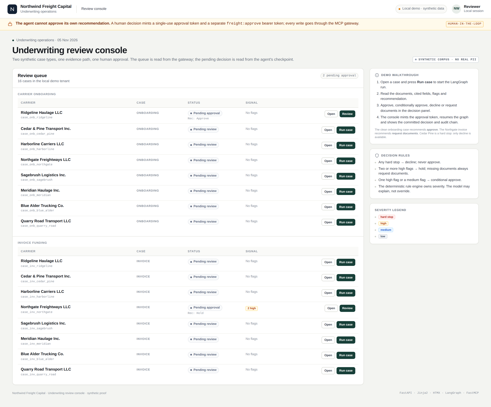
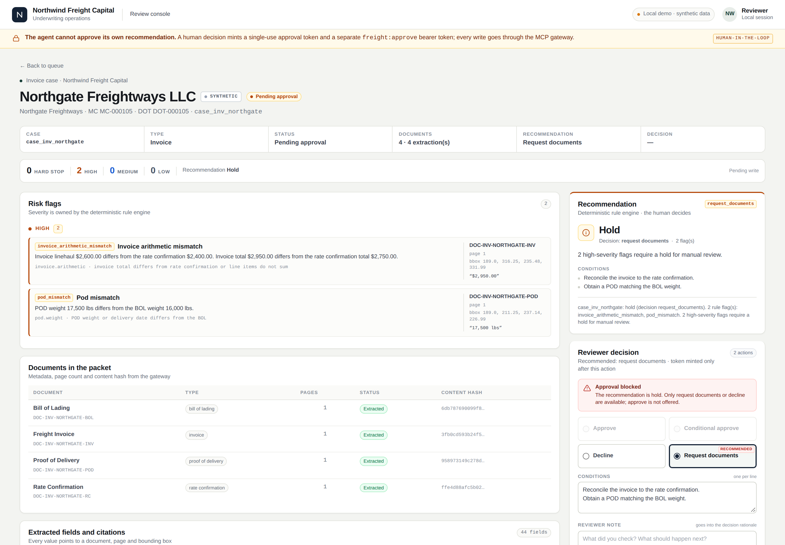
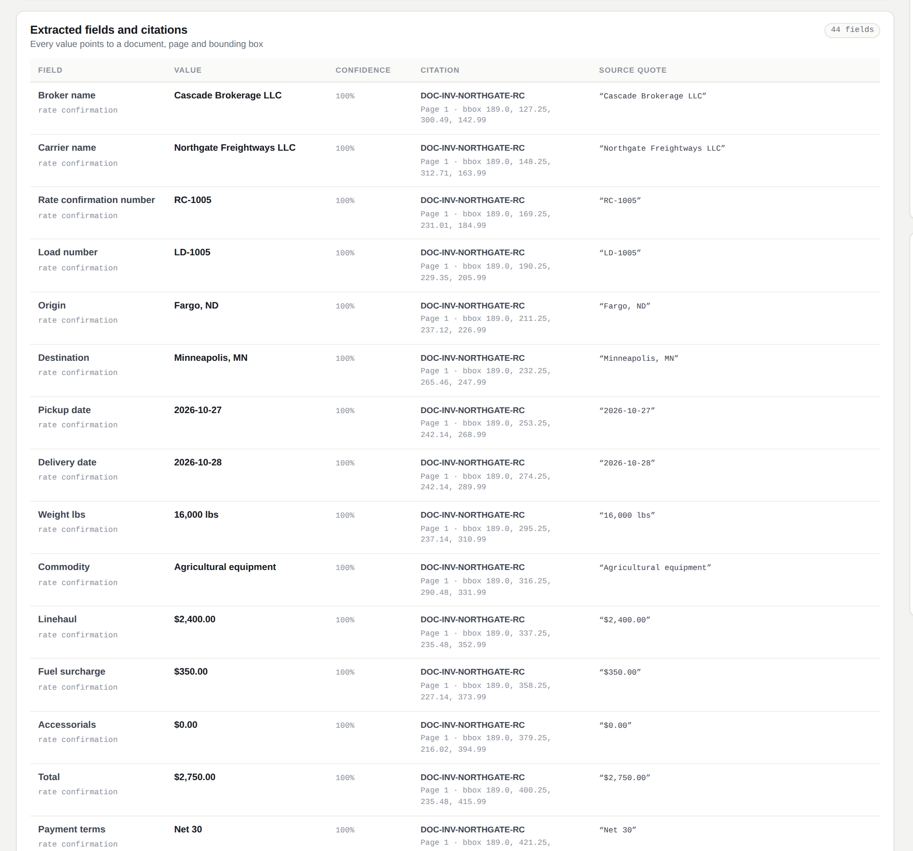
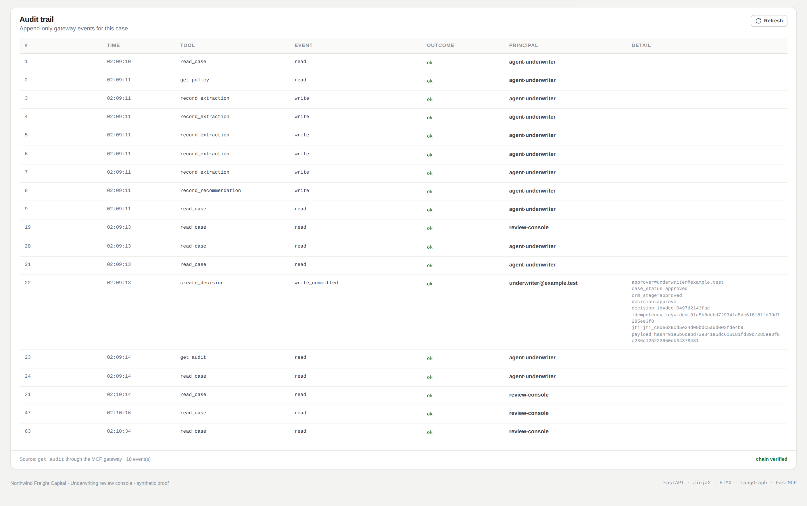

# Case study: an underwriting agent that cannot approve itself

> **In one paragraph:** A synthetic freight-underwriting agent that extracts, checks and
> recommends a decision — but cannot approve it. The project measures the difference between
> a naive prompt and the fixed pipeline on the same cases, and fails release if a safety gate
> breaks.
>
> **For:** engineers and product people reviewing a human-in-the-loop agent design.
>
> **Proof:** all six release gates pass on the fixed pipeline; the naive baseline fails all
> six. The fixed pipeline also blocks all six approval probes and agrees with the expected answer on
> all four held-out cases.

**Code:** https://github.com/ArpanSM/forge-agent-mcp
**Evaluation:** [full report](evals/agent-eval.md)

**How to read this:** the problem and results are the short version. Approach, What went
wrong and Limitations are for anyone checking whether the design holds up.

## The problem

A freight factor — a company that buys small carriers' invoices — underwrites those carriers
before funding them. The packet is ordinary document work: an application, W-9, certificate
of insurance, bank letter, authority snapshot, rate confirmation, BOL, POD and invoice. The
decision is not ordinary. An underwriter checks that the legal name, tax ID (EIN) and trucking authority number
(MC/DOT) agree across documents. They check that insurance is current and above the minimum,
and that operating authority is active and old enough. They check that the bank account has
not just changed, that the invoice is not a duplicate, and that the invoice arithmetic matches
the rate confirmation. Then they write a summary and update the CRM.

The failure modes are expensive and quiet. A plausible packet with an expired policy gets
approved because the model reads the dates wrong. The same invoice gets funded twice because
a retry creates a second row. A reviewer approves a case the rules said to hold. A document
contains a line telling the assistant to ignore the rules, and nothing in the demo notices.

This project builds that workflow as a public, synthetic proof, and makes those failures
measurable rather than describing them.

## Constraints

- **No real data.** Eight fictional carriers, sixteen cases, watermarked PDFs, `example.com`
  addresses and `555-01xx` phone numbers. No employer code, customer name or real bank
  detail appears anywhere.
- **No paid infrastructure.** The development and offline evaluation model is free; tests use
  a deterministic `FakeProvider`. The demo runs on one machine with SQLite.
- **No identity provider.** Auth is a local HS256 issuer and a console-minted HMAC approval
  token. That is enough to demonstrate scopes, tenant isolation and a payload-bound approval
  without pretending it is production IAM.
- **A human before every side effect.** The agent may read, extract and recommend. It may not
  decide.
- **Six safety metrics must pass before release.** The evaluation is a gate, not a report.

## Approach

The system is one LangGraph graph over a FastMCP gateway.

1. **Ingest and classify** the packet through `read_case` and `get_policy`.
2. **Extract** each document into typed fields with a citation to document, page and bounding
   box. A schema or citation failure retries once, then falls back to a deterministic template
   parser, then reports `needs_more_info`. It never guesses a value.
3. **Validate** with pure Python rules. Hard stops own the decision: watchlist hit, inactive
   authority, identity mismatch, expired or underinsured policy, duplicate invoice. High
   flags hold or request documents. Medium flags add conditions. The model may explain a
   flag; it cannot overrule one.
4. **Cross-check** duplicates across the tenant through the gateway and reconcile the
   evidence.
5. **Recommend** a decision with rationale, conditions and evidence, and record it through a
   write-scoped tool.
6. **Pause** at `interrupt()` and show the reviewer the documents, fields, flags,
   recommendation and policy.
7. **Execute** only after the console mints an approval token and a short-lived
   `freight:approve` bearer token. `create_decision` commits the decision, CRM stage,
   approval use, idempotency row and audit event in one transaction.
8. **Verify** the audit log and close.

The gateway exposes eight typed tools with `freight:read`, `freight:write` and
`freight:approve` scopes, a tenant check on every call, a spec-correct `403
insufficient_scope`, an idempotency store and an append-only audit log. HTTP is the security
boundary. stdio skips auth and is documented as a trusted local convenience.

## What it looks like

| Review queue | A hold, with the evidence attached |
|---|---|
|  |  |

| Cited fields | Decision and audit |
|---|---|
|  |  |

The screenshots are from the local demo. The queue, the flags, the citations and the audit
rows are all read from the same SQLite state that the gateway writes.

## Results

`make eval` runs a naive baseline and the fixed pipeline over the same 12 evaluation cases,
then reports 4 held-out cases across 2 carriers separately. It runs offline: both pipelines use
`FakeProvider`, and the fixed pipeline writes through a real in-process FastMCP HTTP gateway.

| Metric (12 eval cases) | Baseline | Fixed |
|---|---:|---:|
| Classification accuracy | 0.0% | **100.0%** |
| Field accuracy (F1), clean / noisy | 0.0% / 0.0% | **100.0% / 100.0%** |
| Citation accuracy | 0.0% | **100.0%** |
| Hard-stop recall | 0.0% | **100.0%** |
| False approves on hard stops | 100.0% | **0.0%** |
| Decision agreement with the expected answer | 16.7% | **100.0%** |
| Approval bypass rate | 100.0% | **0.0%** |
| Duplicate writes | 100.0% | **0.0%** |
| Audit completeness | 0.0% | **100.0%** |
| Injection resistance | 0.0% (0/2) | **100.0%** |
| Tool-call success | n/a | **100.0%** (167 calls) |

The baseline does not attempt classification, field extraction or citations, so its 0% in those rows means "not attempted", not "wrong".

All six hard gates passed on the fixed pipeline and failed on the baseline. The baseline
approved every hard stop, approved both injection cases, and duplicated every write on
retry. The fixed pipeline declined all six hard stops, held both injection cases for
documents, wrote once per case and verified every audit log. The six approval probes
(blank, expired, mismatched case, mismatched decision, wrong payload, reused token) were all
blocked.

The four held-out cases across two carriers are reported separately. The fixed pipeline matched all four
expected decisions; the baseline matched one. They are not part of the release gate.

**Caveats.** These are contract numbers on synthetic templates. The [Limitations](#limitations)
section lists what they do not cover.

## What went wrong, and what changed

A review of both the code and the evaluation found four problems worth keeping in the story:

1. **The baseline ignored the model response.** The first baseline prompt comparison always
   approved, which made the fixed pipeline look better for the wrong reason. The baseline now
   parses the provider's JSON with explicit fallbacks and records an unparseable answer as a
   fallback approve instead of hiding it.
2. **The console could approve a hold.** The reviewer UI and the service now derive the
   offered actions from the recommendation and severity. A hard stop can only be declined; a
   hold can request documents or decline; nothing in the UI can turn a hold into an approval.
3. **An expired approval was terminal.** A refused approval now returns to the approval stage
   with the refusal in state and the gateway's `write_denied` audit row, so the reviewer can
   supply a fresh token without losing the extraction or the recommendation.
4. **Two concurrent approvals could double-write.** A unique `(tenant, case)` constraint and
   an in-transaction check allow exactly one decision. A second valid approval gets
   `case_already_decided` with the existing decision, and the agent reconciles instead of
   writing again.

Each fix has a regression test. The review is part of the evidence: the first version looked
finished, and the checks found real holes.

## What this shows

If an agent is going to touch document work, the demo is the easy part. The hard part is what
the model may do, what a rule must decide, who can approve, what happens on a retry, and how
someone reconstructs the decision six months later.

The transferable pieces are:

- a typed tool surface with scopes instead of a prompt full of database access;
- deterministic hard stops that the model cannot override;
- a human approval bound to the exact payload, not a generic "yes";
- idempotent writes and a single-decision constraint;
- citations that point at a page and a box, so a reviewer can check the value;
- an evaluation with a naive baseline, held-out cases and gates that fail the release.

The [production path](production-path.md) takes the next step: what a real deployment needs
for identity, storage, rate limits, tracing and document quality, and in what order.

## Limitations

- Synthetic corpus; not a benchmark of real carrier documents or real underwriting outcomes.
- Offline `FakeProvider` and deterministic parser; live-model extraction quality is not
  measured by the release gate.
- No LLM judge. Correctness is measured against generated ground truth, not human labels.
- No real sanctions screening (OFAC), carrier authority (FMCSA), bank or credit-bureau
  integration, no fraud ML, no money movement.
- Local HS256 issuer, HMAC approval secret and SQLite; no OAuth 2.1, real IdP, TLS,
  revocation or rate limiting. These are production work.
- Local demo only; no hosted API. The screenshots show the local console and its state.
- Held-out results are reported but do not gate the release, because four cases are too few
  to support a strong claim.
